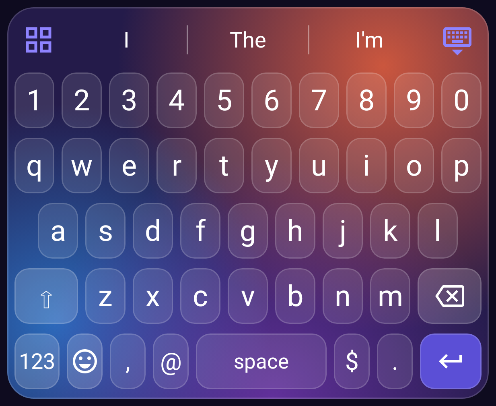

# Glass Keyboard

An Android keyboard (input method) with a frosted-glass look, built with Kotlin and Jetpack Compose.



## Features
- English (UK) QWERTY layout with a number row
- Glass keys over an orange / blue / purple gradient
- Suggestion bar with simple English word completion
- Long-press space to switch keyboards; double-space types ". "
- Customisable symbol keys beside the space bar (default `@` and `$`), edited in the app
- Symbols page (`123`) and emoji page
- No internet permission; suggestions are turned off in password fields

## Open and run
1. Open the `GlassKeyboard` folder in Android Studio (Ladybug or newer).
2. Run the `app` configuration on a phone or emulator (Android 8.0+).
3. In the app, tap **Open settings** to enable Glass Keyboard, then **Choose keyboard**.

## Project layout
| Path | What it does |
|---|---|
| `ime/GlassKeyboardService.kt` | The keyboard service: typing, shift, enter, suggestions |
| `ime/KeyboardScreen.kt` | The glass keyboard UI (colours in the `Glass` object) |
| `ime/Layouts.kt` | Key layouts: letters, symbols, emoji |
| `ime/Suggestions.kt` | Starter word list for the suggestion bar |
| `data/SymbolKeysStore.kt` | Saves the symbol key slots |
| `ui/SettingsActivity.kt` | Setup steps, symbol key editor, test field |

## Tests
```
./gradlew :app:testDebugUnitTest
```
This also renders the keyboard to `app/build/screenshots/`.
